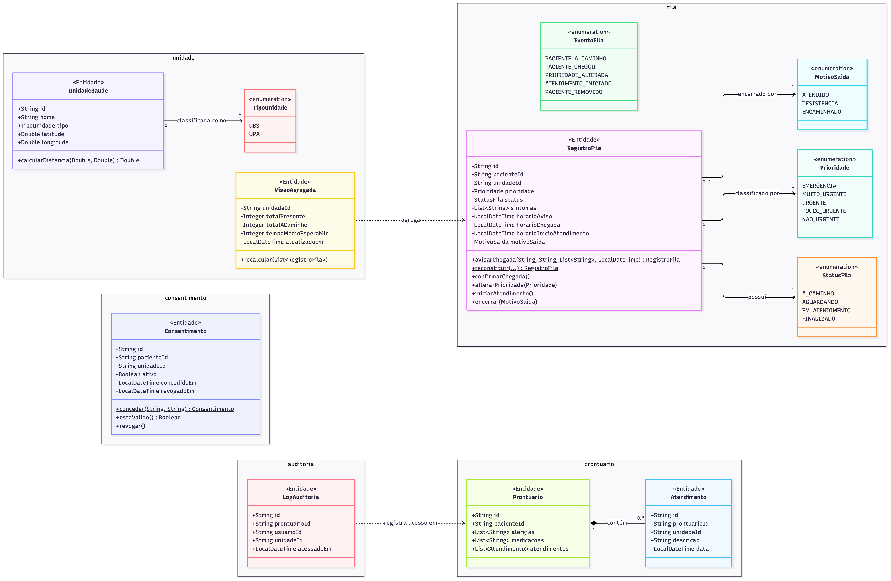
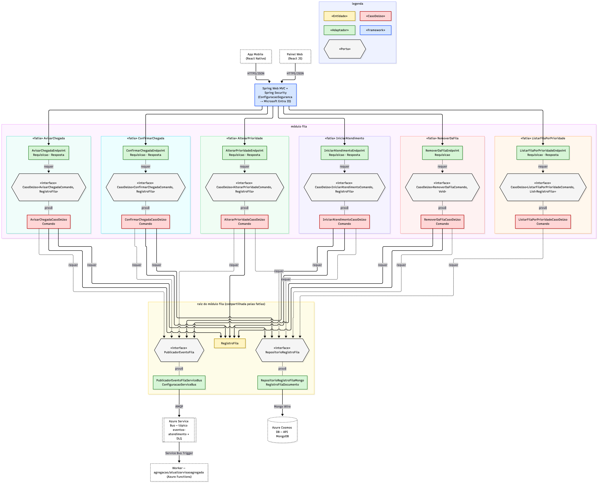

# Prontuário e Filas UBS/UPA — Fatias Verticais + Clean Architecture

## Objetivo

Repositório **mínimo** que representa a arquitetura do backend do *Sistema de Prontuário e Filas UBS/UPA* (TDE 2),
derivada da documentação arc42. O foco é a **estrutura**: todas as classes existem com assinaturas, atributos e
anotações; os corpos são `throw new UnsupportedOperationException("TODO")`.

A única exceção é a fatia **AvisarChegada**, implementada de ponta a ponta para mostrar o fluxo
`Endpoint → CasoDeUso → Entidade → Porta → Adaptador`.

Stack: Spring Boot 3.3 · Java 21 · Azure Cosmos DB (API MongoDB) · Azure Service Bus · Microsoft Entra ID ·
Azure Maps · Azure Functions (Worker).

## Fatias Verticais + Clean Architecture em 30 segundos

- **Fatia vertical**: o código é organizado por **funcionalidade**, nunca por camada técnica. Cada operação da API
  (uma linha da matriz Requisito × Endpoint do arc42) é uma pasta com tudo o que ela precisa. Mudar uma
  funcionalidade = mexer em uma pasta. **Não existem pastas `domain`, `infrastructure`, `controllers`, `services`...**
- **Clean Architecture**: as 4 camadas continuam existindo, mas como **papéis de arquivo** dentro da fatia,
  respeitando a regra de dependência (setas sempre para dentro):

| Papel | Arquivos | Camada |
|---|---|---|
| Adaptador | `<Fatia>Endpoint`, `<Fatia>Requisicao`, `<Fatia>Resposta`; `Repositorio*Mongo`, `Publicador*ServiceBus`, `Gateway*AzureMaps` | Interface Adapters |
| CasoDeUso | `<Fatia>Comando`, `<Fatia>CasoDeUso` | Use Cases |
| Porta | `CasoDeUso<E,S>` (entrada); `Repositorio*`, `Publicador*`, `Gateway*` (saída) | Use Cases |
| Entidade | `RegistroFila`, `Consentimento`, `Prontuario`, `LogAuditoria`, `UnidadeSaude`, `VisaoAgregada` + enums | Entities |
| Framework | `ConfiguracaoSeguranca`, `ResolvedorUsuarioAtual`, `ConfiguracaoServiceBus`, `RegistroFilaDocumento` | Frameworks & Drivers |

Regras:
1. Cada fatia contém `<Fatia>Endpoint`, `<Fatia>Requisicao`, `<Fatia>Resposta`, `<Fatia>Comando` e `<Fatia>CasoDeUso`
   (fatias `204 No Content` e o Worker não têm `Resposta`).
2. Entidades, portas e adaptadores usados por **mais de uma fatia** ficam soltos na **raiz do módulo**; o que é
   exclusivo de uma fatia fica dentro dela (ex.: `GatewayGeolocalizacao` em `listarunidadesproximas/`).
3. **Uma fatia nunca importa classes de outra fatia.**

## Árvore de pastas

```
src/main/java/br/edu/tde/prontuariofilas/
├── AplicacaoProntuarioFilas.java
├── compartilhado/
│   ├── CasoDeUso.java                       # porta de entrada: S executar(E)
│   ├── UsuarioAtual.java
│   ├── RecursoNaoEncontradoExcecao.java     # → 404
│   ├── AcessoNegadoExcecao.java             # → 403
│   ├── RegraDeNegocioExcecao.java           # → 409
│   ├── ConfiguracaoSeguranca.java           # Entra ID (JWT, claim "roles")
│   ├── ResolvedorUsuarioAtual.java
│   └── TratadorExcecoesApi.java
└── funcionalidades/
    ├── fila/
    │   ├── RegistroFila.java  Prioridade.java  StatusFila.java  MotivoSaida.java  EventoFila.java
    │   ├── RepositorioRegistroFila.java  PublicadorEventoFila.java
    │   ├── RepositorioRegistroFilaMongo.java  RegistroFilaDocumento.java
    │   ├── PublicadorEventoFilaServiceBus.java  ConfiguracaoServiceBus.java
    │   ├── avisarchegada/            ✅ Endpoint · Requisicao · Resposta · Comando · CasoDeUso
    │   ├── listarfilaporprioridade/     Endpoint · Requisicao · Resposta · Comando · CasoDeUso
    │   ├── confirmarchegada/            Endpoint · Requisicao · Resposta · Comando · CasoDeUso
    │   ├── alterarprioridade/           Endpoint · Requisicao · Resposta · Comando · CasoDeUso
    │   ├── iniciaratendimento/          Endpoint · Requisicao · Resposta · Comando · CasoDeUso
    │   └── removerdafila/               Endpoint · Requisicao · Comando · CasoDeUso   (204)
    ├── unidade/
    │   ├── UnidadeSaude.java  TipoUnidade.java  VisaoAgregada.java
    │   ├── RepositorioUnidadeSaude.java  RepositorioVisaoAgregada.java
    │   ├── RepositorioUnidadeSaudeMongo.java  RepositorioVisaoAgregadaMongo.java
    │   ├── listarunidadesproximas/      Endpoint · Requisicao · Resposta · Comando · CasoDeUso
    │   │                                + UnidadeProxima · GatewayGeolocalizacao · GatewayGeolocalizacaoAzureMaps
    │   ├── listarminhasunidades/        Endpoint · Requisicao · Resposta · Comando · CasoDeUso
    │   └── consultarvisaoagregada/      Endpoint · Requisicao · Resposta · Comando · CasoDeUso
    ├── consentimento/
    │   ├── Consentimento.java  RepositorioConsentimento.java  RepositorioConsentimentoMongo.java
    │   ├── concederconsentimento/       Endpoint · Requisicao · Resposta · Comando · CasoDeUso
    │   ├── revogarconsentimento/        Endpoint · Requisicao · Comando · CasoDeUso   (204)
    │   └── listarconsentimentos/        Endpoint · Requisicao · Resposta · Comando · CasoDeUso
    ├── prontuario/
    │   ├── Prontuario.java  Atendimento.java  RepositorioProntuario.java  RepositorioProntuarioMongo.java
    │   ├── consultarproprioprontuario/  Endpoint · Requisicao · Resposta · Comando · CasoDeUso
    │   └── consultarprontuario/         Endpoint · Requisicao · Resposta · Comando · CasoDeUso
    ├── auditoria/
    │   ├── LogAuditoria.java  RepositorioLogAuditoria.java  RepositorioLogAuditoriaMongo.java
    │   └── listarauditoriaprontuario/   Endpoint · Requisicao · Resposta · Comando · CasoDeUso
    └── agregacao/
        └── atualizarvisaoagregada/      Endpoint (Service Bus Trigger) · Requisicao · Comando · CasoDeUso
```

## Fatias × Endpoints (matriz de rastreabilidade do arc42)

| Fatia | Rota | RF |
|---|---|---|
| AvisarChegada ✅ | `POST /fila/{unidadeId}/aviso-chegada` | RF03, RF04, RF17 |
| ListarFilaPorPrioridade | `GET /fila/{unidadeId}` | RF08, RF09 |
| ConfirmarChegada | `POST /fila/{registroId}/confirmar-chegada` | RF10 |
| AlterarPrioridade | `PATCH /fila/{registroId}/prioridade` | RF11 |
| IniciarAtendimento | `POST /fila/{registroId}/iniciar-atendimento` | RF13 |
| RemoverDaFila | `DELETE /fila/{registroId}?motivo=` | RF14 |
| ListarUnidadesProximas | `GET /unidades/proximas` | RF02 |
| ListarMinhasUnidades | `GET /unidades/minhas` | RF07 |
| ConsultarVisaoAgregada | `GET /unidades/{unidadeId}/visao-agregada` | RF18 |
| ConcederConsentimento | `POST /consentimentos` | RF05 |
| RevogarConsentimento | `DELETE /consentimentos/{consentimentoId}` | RF05 |
| ListarConsentimentos | `GET /consentimentos` | RF06 |
| ConsultarProprioProntuario | `GET /prontuarios/me` | RF06 |
| ConsultarProntuario | `GET /prontuarios/{pacienteId}?unidadeId=` | RF12, RF15 |
| ListarAuditoriaProntuario | `GET /auditoria/prontuarios/{prontuarioId}` | RF16 |
| AtualizarVisaoAgregada (Worker) | Service Bus `eventos-atendimento` | RF17, RF18 |

RF01 (autenticação) é delegado ao Microsoft Entra ID.

## Princípio SOLID → onde aparece

| Princípio | Onde aparece |
|---|---|
| **S** — Responsabilidade Única | Cada fatia tem **um** `CasoDeUso` com **um** método `executar`; o `Endpoint` só traduz HTTP; `Requisicao`/`Resposta` só carregam dados; os adaptadores só traduzem para Mongo/Service Bus/Azure Maps. |
| **O** — Aberto/Fechado | Nova funcionalidade = **nova pasta de fatia**, sem alterar as existentes. Trocar Cosmos DB ou Service Bus = novo adaptador implementando a mesma porta. |
| **L** — Substituição de Liskov | Qualquer implementação de `RepositorioRegistroFila`/`PublicadorEventoFila` (Mongo, em memória, falsa para testes) substitui a outra sem o caso de uso perceber. Todo `<Fatia>CasoDeUso` é intercambiável como `CasoDeUso<E,S>`. |
| **I** — Segregação de Interfaces | Portas pequenas e específicas (`PublicadorEventoFila`, `RepositorioProntuario` e `GatewayGeolocalizacao` têm 1 método; `CasoDeUso<E,S>` tem 1 método) — ninguém depende de um "Service" com 6 operações como o `FilaService` do arc42 §5.3. |
| **D** — Inversão de Dependência | Casos de uso dependem de **interfaces** (portas), nunca de `MongoTemplate` ou `ServiceBusSenderClient`. Endpoints dependem de `CasoDeUso<E,S>`, não da classe concreta. Entidades não têm anotações de Spring/Mongo. |

## Decisões de simplificação

- Um único projeto Maven contém a API e o Worker (`agregacao`); em produção o Worker é empacotado à parte para Azure Functions.
- Casos de uso usam `@Service` apenas para registro no contêiner; nenhum tipo do Spring aparece em suas assinaturas.
- `Requisicao` = entrada HTTP da fatia: o corpo (`@RequestBody`) ou, quando não há corpo, os parâmetros de rota/consulta (`@ModelAttribute`).
- `Paciente` não é entidade própria: a identidade vem do token Entra ID (`UsuarioAtual`).
- Dead-letter: nativo do Service Bus (exceção no Worker → reentrega → DLQ após `maxDeliveryCount`).

## Executar

Variáveis: `COSMOS_MONGODB_URI`, `AZURE_TENANT_ID`, `AZURE_API_CLIENT_ID`, `SERVICEBUS_CONNECTION_STRING`, `AZURE_MAPS_KEY`.

```bash
mvn spring-boot:run
```

## Documentação

- [docs/arquitetura-vertical-slice.md](docs/arquitetura-vertical-slice.md) — diagramas de classes (namespace por fatia), de componentes (uma coluna por fatia) e fluxo da fatia de exemplo
- [docs/img/](docs/img/) — imagens geradas

| | |
|---|---|
| Entidades |  |
| Componentes — módulo fila |  |
