# Arquitetura em Fatias Verticais (Vertical Slice) + Clean Architecture

Backend do **Sistema de Prontuário e Filas UBS/UPA** (TDE 2). Fonte da verdade: `arc42_prontuario_filas.md`
(RF01–RF18, matriz Requisito × Endpoint, §5.3, §6.3 e §8).

## Regras de organização

1. **Não há pastas de camada.** O código é organizado por **funcionalidade**: `funcionalidades/<módulo>/<fatia>/`.
   Cada fatia é uma operação da matriz de rastreabilidade.
2. As 4 camadas da Clean Architecture existem como **papéis de arquivo** dentro da fatia:

| Papel (estereótipo) | Arquivo | Camada |
|---|---|---|
| `<<Adaptador>>` | `<Fatia>Endpoint`, `<Fatia>Requisicao`, `<Fatia>Resposta` (na fatia); `Repositorio*Mongo`, `Publicador*ServiceBus`, `Gateway*AzureMaps` | Interface Adapters |
| `<<CasoDeUso>>` | `<Fatia>Comando`, `<Fatia>CasoDeUso` | Use Cases |
| `<<Porta>>` | `CasoDeUso<E,S>` (entrada) e `Repositorio*`, `Publicador*`, `Gateway*` (saída) — na fatia se for exclusiva, na raiz do módulo se for compartilhada | Use Cases |
| `<<Entidade>>` | na raiz do módulo (compartilhada pelas fatias) | Entities |
| `<<Framework>>` | `ConfiguracaoSeguranca`, `ResolvedorUsuarioAtual`, `ConfiguracaoServiceBus`, `RegistroFilaDocumento`, Spring, SDKs Azure | Frameworks & Drivers |

3. **Entidades, portas e adaptadores usados por mais de uma fatia ficam soltos na raiz do módulo**
   (ex.: `fila/RegistroFila.java`, `fila/RepositorioRegistroFila.java`, `fila/RepositorioRegistroFilaMongo.java`).
   **Uma fatia nunca importa classes de outra fatia** — só da raiz do próprio módulo, da raiz de outro módulo ou de `compartilhado/`.
4. Exceções ao "5 arquivos por fatia": `RemoverDaFila` e `RevogarConsentimento` respondem `204 No Content`
   (sem `Resposta`); o Worker `AtualizarVisaoAgregada` é acionado pelo Service Bus (sem `Resposta`).

## Matriz Fatia × Papel

| Módulo | Fatia (operationId) | RF | Endpoint | CasoDeUso | Portas usadas | Entidades |
|---|---|---|---|---|---|---|
| fila | `avisarChegada` ✅ implementada | RF03, RF04, RF17 | `POST /fila/{unidadeId}/aviso-chegada` | `AvisarChegadaCasoDeUso` | `RepositorioRegistroFila`, `PublicadorEventoFila` | `RegistroFila` |
| fila | `listarFilaPorPrioridade` | RF08, RF09 | `GET /fila/{unidadeId}` | `ListarFilaPorPrioridadeCasoDeUso` | `RepositorioRegistroFila` | `RegistroFila` |
| fila | `confirmarChegada` | RF10, RF17 | `POST /fila/{registroId}/confirmar-chegada` | `ConfirmarChegadaCasoDeUso` | `RepositorioRegistroFila`, `PublicadorEventoFila` | `RegistroFila` |
| fila | `alterarPrioridade` | RF11, RF17 | `PATCH /fila/{registroId}/prioridade` | `AlterarPrioridadeCasoDeUso` | `RepositorioRegistroFila`, `PublicadorEventoFila` | `RegistroFila` |
| fila | `iniciarAtendimento` | RF13, RF17 | `POST /fila/{registroId}/iniciar-atendimento` | `IniciarAtendimentoCasoDeUso` | `RepositorioRegistroFila`, `PublicadorEventoFila` | `RegistroFila` |
| fila | `removerDaFila` | RF14, RF17 | `DELETE /fila/{registroId}?motivo=` | `RemoverDaFilaCasoDeUso` | `RepositorioRegistroFila`, `PublicadorEventoFila` | `RegistroFila` |
| unidade | `listarUnidadesProximas` | RF02 | `GET /unidades/proximas` | `ListarUnidadesProximasCasoDeUso` | `RepositorioUnidadeSaude`, `RepositorioVisaoAgregada`, `GatewayGeolocalizacao` (da fatia) | `UnidadeSaude`, `VisaoAgregada` |
| unidade | `listarMinhasUnidades` | RF07 | `GET /unidades/minhas` | `ListarMinhasUnidadesCasoDeUso` | `RepositorioUnidadeSaude` | `UnidadeSaude` |
| unidade | `consultarVisaoAgregada` | RF18 | `GET /unidades/{unidadeId}/visao-agregada` | `ConsultarVisaoAgregadaCasoDeUso` | `RepositorioVisaoAgregada` | `VisaoAgregada` |
| consentimento | `concederConsentimento` | RF05 | `POST /consentimentos` | `ConcederConsentimentoCasoDeUso` | `RepositorioConsentimento` | `Consentimento` |
| consentimento | `revogarConsentimento` | RF05 | `DELETE /consentimentos/{consentimentoId}` | `RevogarConsentimentoCasoDeUso` | `RepositorioConsentimento` | `Consentimento` |
| consentimento | `listarConsentimentos` | RF06 | `GET /consentimentos` | `ListarConsentimentosCasoDeUso` | `RepositorioConsentimento` | `Consentimento` |
| prontuario | `consultarProprioProntuario` | RF06 | `GET /prontuarios/me` | `ConsultarProprioProntuarioCasoDeUso` | `RepositorioProntuario` | `Prontuario` |
| prontuario | `consultarProntuario` | RF12, RF15 | `GET /prontuarios/{pacienteId}?unidadeId=` | `ConsultarProntuarioCasoDeUso` | `RepositorioProntuario`, `RepositorioConsentimento`, `RepositorioLogAuditoria` | `Prontuario`, `Consentimento`, `LogAuditoria` |
| auditoria | `listarAuditoriaProntuario` | RF16 | `GET /auditoria/prontuarios/{prontuarioId}` | `ListarAuditoriaProntuarioCasoDeUso` | `RepositorioLogAuditoria` | `LogAuditoria` |
| agregacao | Worker (Service Bus Trigger) | RF17, RF18 | tópico `eventos-atendimento` | `AtualizarVisaoAgregadaCasoDeUso` | `RepositorioRegistroFila`, `RepositorioVisaoAgregada` | `VisaoAgregada`, `RegistroFila` |

RF01 é delegado ao Microsoft Entra ID (`compartilhado/ConfiguracaoSeguranca`).

---

## 1. Diagramas de Classes (namespace por fatia)

### 1.1 Entidades (raiz de cada módulo)

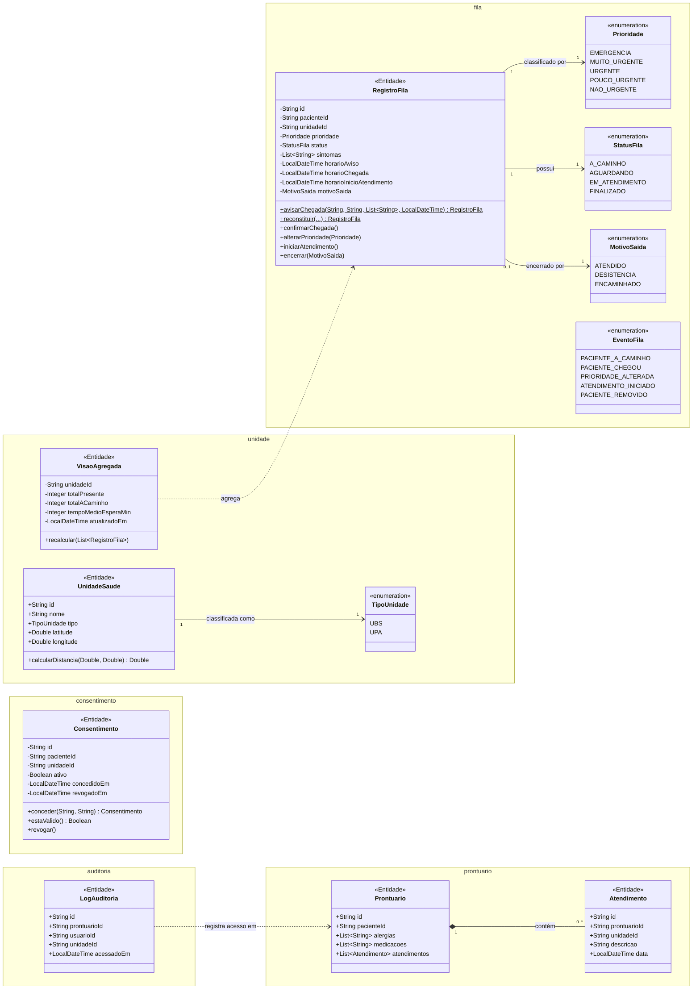

### 1.2 Módulo `fila` — fatias AvisarChegada (implementada) e ListarFilaPorPrioridade + raiz do módulo

```mermaid
classDiagram
    direction LR
    namespace compartilhado {
        class CasoDeUso~E,S~ {
            <<Porta>>
            +executar(E entrada) S
        }
        class UsuarioAtual {
            <<CasoDeUso>>
            +String id
            +Set~String~ perfis
            +List~String~ unidadeIds
            +lotadoEm(String) boolean
        }
    }
    namespace fila_avisarchegada {
        class AvisarChegadaEndpoint {
            <<Adaptador>>
            +avisar(String unidadeId, AvisarChegadaRequisicao, UsuarioAtual) AvisarChegadaResposta
        }
        class AvisarChegadaRequisicao {
            <<Adaptador>>
            +List~String~ sintomas
        }
        class AvisarChegadaResposta {
            <<Adaptador>>
            +String registroId
            +String unidadeId
            +StatusFila status
            +Prioridade prioridade
            +LocalDateTime horarioAviso
            +de(RegistroFila)$ AvisarChegadaResposta
        }
        class AvisarChegadaComando {
            <<CasoDeUso>>
            +String pacienteId
            +String unidadeId
            +List~String~ sintomas
        }
        class AvisarChegadaCasoDeUso {
            <<CasoDeUso>>
            +executar(AvisarChegadaComando) RegistroFila
        }
    }
    namespace fila_listarfilaporprioridade {
        class ListarFilaPorPrioridadeEndpoint {
            <<Adaptador>>
            +listar(ListarFilaPorPrioridadeRequisicao) List~ListarFilaPorPrioridadeResposta~
        }
        class ListarFilaPorPrioridadeRequisicao {
            <<Adaptador>>
            +String unidadeId
            +StatusFila status
        }
        class ListarFilaPorPrioridadeResposta {
            <<Adaptador>>
            +String registroId
            +Prioridade prioridade
            +StatusFila status
            +boolean presente
        }
        class ListarFilaPorPrioridadeComando {
            <<CasoDeUso>>
            +String unidadeId
            +StatusFila status
        }
        class ListarFilaPorPrioridadeCasoDeUso {
            <<CasoDeUso>>
            +executar(ListarFilaPorPrioridadeComando) List~RegistroFila~
        }
    }
    namespace fila {
        class RegistroFila {
            <<Entidade>>
            +avisarChegada(String, String, List~String~, LocalDateTime)$ RegistroFila
            +confirmarChegada()
            +alterarPrioridade(Prioridade)
            +iniciarAtendimento()
            +encerrar(MotivoSaida)
        }
        class RepositorioRegistroFila {
            <<Porta>>
            +salvar(RegistroFila)
            +buscarPorId(String) Optional~RegistroFila~
            +listarAtivosPorUnidade(String) List~RegistroFila~
        }
        class PublicadorEventoFila {
            <<Porta>>
            +publicar(EventoFila, RegistroFila)
        }
        class RepositorioRegistroFilaMongo {
            <<Adaptador>>
            -MongoTemplate mongo
        }
        class PublicadorEventoFilaServiceBus {
            <<Adaptador>>
            -ServiceBusSenderClient remetente
        }
        class RegistroFilaDocumento {
            <<Framework>>
            +de(RegistroFila)$ RegistroFilaDocumento
            +paraDominio() RegistroFila
        }
        class ConfiguracaoServiceBus {
            <<Framework>>
            +remetenteEventosAtendimento(String, String) ServiceBusSenderClient
        }
    }
    namespace frameworks {
        class MongoTemplate {
            <<Framework>>
        }
        class ServiceBusSenderClient {
            <<Framework>>
        }
    }

    AvisarChegadaEndpoint ..> CasoDeUso : usa
    AvisarChegadaEndpoint ..> AvisarChegadaRequisicao
    AvisarChegadaEndpoint ..> AvisarChegadaResposta
    AvisarChegadaEndpoint ..> UsuarioAtual
    AvisarChegadaCasoDeUso ..|> CasoDeUso
    AvisarChegadaCasoDeUso ..> AvisarChegadaComando
    AvisarChegadaCasoDeUso ..> RegistroFila
    AvisarChegadaCasoDeUso ..> RepositorioRegistroFila
    AvisarChegadaCasoDeUso ..> PublicadorEventoFila

    ListarFilaPorPrioridadeEndpoint ..> CasoDeUso : usa
    ListarFilaPorPrioridadeEndpoint ..> ListarFilaPorPrioridadeRequisicao
    ListarFilaPorPrioridadeEndpoint ..> ListarFilaPorPrioridadeResposta
    ListarFilaPorPrioridadeCasoDeUso ..|> CasoDeUso
    ListarFilaPorPrioridadeCasoDeUso ..> ListarFilaPorPrioridadeComando
    ListarFilaPorPrioridadeCasoDeUso ..> RepositorioRegistroFila

    RepositorioRegistroFilaMongo ..|> RepositorioRegistroFila
    PublicadorEventoFilaServiceBus ..|> PublicadorEventoFila
    RepositorioRegistroFilaMongo ..> RegistroFilaDocumento
    RepositorioRegistroFilaMongo ..> MongoTemplate
    PublicadorEventoFilaServiceBus ..> ServiceBusSenderClient
    ConfiguracaoServiceBus ..> ServiceBusSenderClient : cria
```

### 1.3 Módulo `fila` — fatias de transição de estado

Os adaptadores que implementam as portas da raiz do módulo estão no diagrama 1.2.

```mermaid
classDiagram
    direction LR
    namespace compartilhado {
        class CasoDeUso~E,S~ {
            <<Porta>>
            +executar(E entrada) S
        }
    }
    namespace fila_confirmarchegada {
        class ConfirmarChegadaEndpoint {
            <<Adaptador>>
            +confirmar(ConfirmarChegadaRequisicao) ConfirmarChegadaResposta
        }
        class ConfirmarChegadaRequisicao {
            <<Adaptador>>
            +String registroId
        }
        class ConfirmarChegadaResposta {
            <<Adaptador>>
            +String registroId
            +StatusFila status
            +LocalDateTime horarioChegada
        }
        class ConfirmarChegadaComando {
            <<CasoDeUso>>
            +String registroId
        }
        class ConfirmarChegadaCasoDeUso {
            <<CasoDeUso>>
            +executar(ConfirmarChegadaComando) RegistroFila
        }
    }
    namespace fila_alterarprioridade {
        class AlterarPrioridadeEndpoint {
            <<Adaptador>>
            +alterar(String registroId, AlterarPrioridadeRequisicao) AlterarPrioridadeResposta
        }
        class AlterarPrioridadeRequisicao {
            <<Adaptador>>
            +Prioridade prioridade
        }
        class AlterarPrioridadeResposta {
            <<Adaptador>>
            +String registroId
            +Prioridade prioridade
            +StatusFila status
        }
        class AlterarPrioridadeComando {
            <<CasoDeUso>>
            +String registroId
            +Prioridade novaPrioridade
        }
        class AlterarPrioridadeCasoDeUso {
            <<CasoDeUso>>
            +executar(AlterarPrioridadeComando) RegistroFila
        }
    }
    namespace fila_iniciaratendimento {
        class IniciarAtendimentoEndpoint {
            <<Adaptador>>
            +iniciar(IniciarAtendimentoRequisicao) IniciarAtendimentoResposta
        }
        class IniciarAtendimentoRequisicao {
            <<Adaptador>>
            +String registroId
        }
        class IniciarAtendimentoResposta {
            <<Adaptador>>
            +String registroId
            +StatusFila status
            +LocalDateTime horarioInicioAtendimento
        }
        class IniciarAtendimentoComando {
            <<CasoDeUso>>
            +String registroId
        }
        class IniciarAtendimentoCasoDeUso {
            <<CasoDeUso>>
            +executar(IniciarAtendimentoComando) RegistroFila
        }
    }
    namespace fila_removerdafila {
        class RemoverDaFilaEndpoint {
            <<Adaptador>>
            +remover(RemoverDaFilaRequisicao)
        }
        class RemoverDaFilaRequisicao {
            <<Adaptador>>
            +String registroId
            +MotivoSaida motivo
        }
        class RemoverDaFilaComando {
            <<CasoDeUso>>
            +String registroId
            +MotivoSaida motivo
        }
        class RemoverDaFilaCasoDeUso {
            <<CasoDeUso>>
            +executar(RemoverDaFilaComando) Void
        }
    }
    namespace fila {
        class RegistroFila {
            <<Entidade>>
            +confirmarChegada()
            +alterarPrioridade(Prioridade)
            +iniciarAtendimento()
            +encerrar(MotivoSaida)
        }
        class RepositorioRegistroFila {
            <<Porta>>
            +salvar(RegistroFila)
            +buscarPorId(String) Optional~RegistroFila~
        }
        class PublicadorEventoFila {
            <<Porta>>
            +publicar(EventoFila, RegistroFila)
        }
    }

    ConfirmarChegadaEndpoint ..> CasoDeUso : usa
    ConfirmarChegadaEndpoint ..> ConfirmarChegadaRequisicao
    ConfirmarChegadaEndpoint ..> ConfirmarChegadaResposta
    ConfirmarChegadaCasoDeUso ..|> CasoDeUso
    ConfirmarChegadaCasoDeUso ..> ConfirmarChegadaComando
    ConfirmarChegadaCasoDeUso ..> RegistroFila
    ConfirmarChegadaCasoDeUso ..> RepositorioRegistroFila
    ConfirmarChegadaCasoDeUso ..> PublicadorEventoFila

    AlterarPrioridadeEndpoint ..> CasoDeUso : usa
    AlterarPrioridadeEndpoint ..> AlterarPrioridadeRequisicao
    AlterarPrioridadeEndpoint ..> AlterarPrioridadeResposta
    AlterarPrioridadeCasoDeUso ..|> CasoDeUso
    AlterarPrioridadeCasoDeUso ..> AlterarPrioridadeComando
    AlterarPrioridadeCasoDeUso ..> RegistroFila
    AlterarPrioridadeCasoDeUso ..> RepositorioRegistroFila
    AlterarPrioridadeCasoDeUso ..> PublicadorEventoFila

    IniciarAtendimentoEndpoint ..> CasoDeUso : usa
    IniciarAtendimentoEndpoint ..> IniciarAtendimentoRequisicao
    IniciarAtendimentoEndpoint ..> IniciarAtendimentoResposta
    IniciarAtendimentoCasoDeUso ..|> CasoDeUso
    IniciarAtendimentoCasoDeUso ..> IniciarAtendimentoComando
    IniciarAtendimentoCasoDeUso ..> RegistroFila
    IniciarAtendimentoCasoDeUso ..> RepositorioRegistroFila
    IniciarAtendimentoCasoDeUso ..> PublicadorEventoFila

    RemoverDaFilaEndpoint ..> CasoDeUso : usa
    RemoverDaFilaEndpoint ..> RemoverDaFilaRequisicao
    RemoverDaFilaCasoDeUso ..|> CasoDeUso
    RemoverDaFilaCasoDeUso ..> RemoverDaFilaComando
    RemoverDaFilaCasoDeUso ..> RegistroFila
    RemoverDaFilaCasoDeUso ..> RepositorioRegistroFila
    RemoverDaFilaCasoDeUso ..> PublicadorEventoFila
```

### 1.4 Módulo `unidade`

```mermaid
classDiagram
    direction LR
    namespace compartilhado {
        class CasoDeUso~E,S~ {
            <<Porta>>
            +executar(E entrada) S
        }
    }
    namespace unidade_listarunidadesproximas {
        class ListarUnidadesProximasEndpoint {
            <<Adaptador>>
            +listar(ListarUnidadesProximasRequisicao) List~ListarUnidadesProximasResposta~
        }
        class ListarUnidadesProximasRequisicao {
            <<Adaptador>>
            +Double latitude
            +Double longitude
            +Double raioKm
        }
        class ListarUnidadesProximasResposta {
            <<Adaptador>>
            +String unidadeId
            +Double distanciaKm
            +Integer totalPresente
            +Integer totalACaminho
            +Integer tempoMedioEsperaMin
        }
        class ListarUnidadesProximasComando {
            <<CasoDeUso>>
            +Double latitude
            +Double longitude
            +Double raioKm
        }
        class ListarUnidadesProximasCasoDeUso {
            <<CasoDeUso>>
            +executar(ListarUnidadesProximasComando) List~UnidadeProxima~
        }
        class UnidadeProxima {
            <<CasoDeUso>>
            +UnidadeSaude unidade
            +Double distanciaKm
            +VisaoAgregada visao
        }
        class GatewayGeolocalizacao {
            <<Porta>>
            +calcularDistanciasKm(Double, Double, List~UnidadeSaude~) Map~String,Double~
        }
        class GatewayGeolocalizacaoAzureMaps {
            <<Adaptador>>
            -RestClient azureMaps
        }
    }
    namespace unidade_listarminhasunidades {
        class ListarMinhasUnidadesEndpoint {
            <<Adaptador>>
            +listar(ListarMinhasUnidadesRequisicao, UsuarioAtual) List~ListarMinhasUnidadesResposta~
        }
        class ListarMinhasUnidadesRequisicao {
            <<Adaptador>>
        }
        class ListarMinhasUnidadesResposta {
            <<Adaptador>>
            +String unidadeId
            +String nome
            +TipoUnidade tipo
        }
        class ListarMinhasUnidadesComando {
            <<CasoDeUso>>
            +List~String~ unidadeIds
        }
        class ListarMinhasUnidadesCasoDeUso {
            <<CasoDeUso>>
            +executar(ListarMinhasUnidadesComando) List~UnidadeSaude~
        }
    }
    namespace unidade_consultarvisaoagregada {
        class ConsultarVisaoAgregadaEndpoint {
            <<Adaptador>>
            +consultar(ConsultarVisaoAgregadaRequisicao) ConsultarVisaoAgregadaResposta
        }
        class ConsultarVisaoAgregadaRequisicao {
            <<Adaptador>>
            +String unidadeId
        }
        class ConsultarVisaoAgregadaResposta {
            <<Adaptador>>
            +String unidadeId
            +Integer totalPresente
            +Integer totalACaminho
            +Integer tempoMedioEsperaMin
            +LocalDateTime atualizadoEm
        }
        class ConsultarVisaoAgregadaComando {
            <<CasoDeUso>>
            +String unidadeId
        }
        class ConsultarVisaoAgregadaCasoDeUso {
            <<CasoDeUso>>
            +executar(ConsultarVisaoAgregadaComando) VisaoAgregada
        }
    }
    namespace unidade {
        class UnidadeSaude {
            <<Entidade>>
            +calcularDistancia(Double, Double) Double
        }
        class VisaoAgregada {
            <<Entidade>>
            +recalcular(List~RegistroFila~)
        }
        class RepositorioUnidadeSaude {
            <<Porta>>
            +buscarPorId(String) Optional~UnidadeSaude~
            +listarTodas() List~UnidadeSaude~
            +listarPorIds(List~String~) List~UnidadeSaude~
        }
        class RepositorioVisaoAgregada {
            <<Porta>>
            +buscarPorUnidade(String) Optional~VisaoAgregada~
            +salvar(VisaoAgregada)
        }
        class RepositorioUnidadeSaudeMongo {
            <<Adaptador>>
            -MongoTemplate mongo
        }
        class RepositorioVisaoAgregadaMongo {
            <<Adaptador>>
            -MongoTemplate mongo
        }
    }
    namespace frameworks {
        class MongoTemplate {
            <<Framework>>
        }
        class RestClient {
            <<Framework>>
        }
    }

    ListarUnidadesProximasEndpoint ..> CasoDeUso : usa
    ListarUnidadesProximasEndpoint ..> ListarUnidadesProximasRequisicao
    ListarUnidadesProximasEndpoint ..> ListarUnidadesProximasResposta
    ListarUnidadesProximasCasoDeUso ..|> CasoDeUso
    ListarUnidadesProximasCasoDeUso ..> ListarUnidadesProximasComando
    ListarUnidadesProximasCasoDeUso ..> UnidadeProxima
    ListarUnidadesProximasCasoDeUso ..> RepositorioUnidadeSaude
    ListarUnidadesProximasCasoDeUso ..> RepositorioVisaoAgregada
    ListarUnidadesProximasCasoDeUso ..> GatewayGeolocalizacao
    GatewayGeolocalizacaoAzureMaps ..|> GatewayGeolocalizacao
    GatewayGeolocalizacaoAzureMaps ..> RestClient
    UnidadeProxima ..> UnidadeSaude
    UnidadeProxima ..> VisaoAgregada

    ListarMinhasUnidadesEndpoint ..> CasoDeUso : usa
    ListarMinhasUnidadesEndpoint ..> ListarMinhasUnidadesRequisicao
    ListarMinhasUnidadesEndpoint ..> ListarMinhasUnidadesResposta
    ListarMinhasUnidadesCasoDeUso ..|> CasoDeUso
    ListarMinhasUnidadesCasoDeUso ..> ListarMinhasUnidadesComando
    ListarMinhasUnidadesCasoDeUso ..> RepositorioUnidadeSaude

    ConsultarVisaoAgregadaEndpoint ..> CasoDeUso : usa
    ConsultarVisaoAgregadaEndpoint ..> ConsultarVisaoAgregadaRequisicao
    ConsultarVisaoAgregadaEndpoint ..> ConsultarVisaoAgregadaResposta
    ConsultarVisaoAgregadaCasoDeUso ..|> CasoDeUso
    ConsultarVisaoAgregadaCasoDeUso ..> ConsultarVisaoAgregadaComando
    ConsultarVisaoAgregadaCasoDeUso ..> RepositorioVisaoAgregada

    RepositorioUnidadeSaudeMongo ..|> RepositorioUnidadeSaude
    RepositorioVisaoAgregadaMongo ..|> RepositorioVisaoAgregada
    RepositorioUnidadeSaudeMongo ..> MongoTemplate
    RepositorioVisaoAgregadaMongo ..> MongoTemplate
```

### 1.5 Módulo `consentimento`

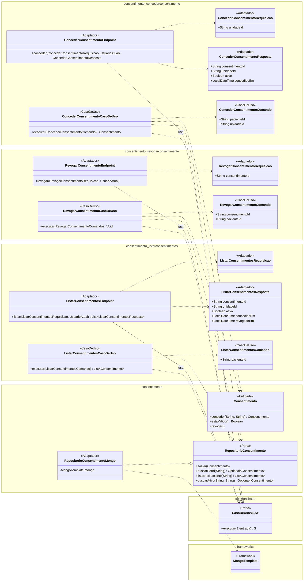

### 1.6 Módulos `prontuario` e `auditoria`

```mermaid
classDiagram
    direction LR
    namespace compartilhado {
        class CasoDeUso~E,S~ {
            <<Porta>>
            +executar(E entrada) S
        }
    }
    namespace prontuario_consultarproprioprontuario {
        class ConsultarProprioProntuarioEndpoint {
            <<Adaptador>>
            +consultar(ConsultarProprioProntuarioRequisicao, UsuarioAtual) ConsultarProprioProntuarioResposta
        }
        class ConsultarProprioProntuarioRequisicao {
            <<Adaptador>>
        }
        class ConsultarProprioProntuarioResposta {
            <<Adaptador>>
            +String prontuarioId
            +List~String~ alergias
            +List~String~ medicacoes
            +List~ItemAtendimento~ atendimentos
        }
        class ConsultarProprioProntuarioComando {
            <<CasoDeUso>>
            +String pacienteId
        }
        class ConsultarProprioProntuarioCasoDeUso {
            <<CasoDeUso>>
            +executar(ConsultarProprioProntuarioComando) Prontuario
        }
    }
    namespace prontuario_consultarprontuario {
        class ConsultarProntuarioEndpoint {
            <<Adaptador>>
            +consultar(ConsultarProntuarioRequisicao, UsuarioAtual) ConsultarProntuarioResposta
        }
        class ConsultarProntuarioRequisicao {
            <<Adaptador>>
            +String pacienteId
            +String unidadeId
        }
        class ConsultarProntuarioResposta {
            <<Adaptador>>
            +String prontuarioId
            +String pacienteId
            +List~String~ alergias
            +List~String~ medicacoes
            +List~ItemAtendimento~ atendimentos
        }
        class ConsultarProntuarioComando {
            <<CasoDeUso>>
            +String pacienteId
            +String unidadeId
            +UsuarioAtual usuario
        }
        class ConsultarProntuarioCasoDeUso {
            <<CasoDeUso>>
            +executar(ConsultarProntuarioComando) Prontuario
        }
    }
    namespace auditoria_listarauditoriaprontuario {
        class ListarAuditoriaProntuarioEndpoint {
            <<Adaptador>>
            +listar(ListarAuditoriaProntuarioRequisicao) List~ListarAuditoriaProntuarioResposta~
        }
        class ListarAuditoriaProntuarioRequisicao {
            <<Adaptador>>
            +String prontuarioId
        }
        class ListarAuditoriaProntuarioResposta {
            <<Adaptador>>
            +String usuarioId
            +String unidadeId
            +LocalDateTime acessadoEm
        }
        class ListarAuditoriaProntuarioComando {
            <<CasoDeUso>>
            +String prontuarioId
        }
        class ListarAuditoriaProntuarioCasoDeUso {
            <<CasoDeUso>>
            +executar(ListarAuditoriaProntuarioComando) List~LogAuditoria~
        }
    }
    namespace raizes_dos_modulos {
        class Prontuario {
            <<Entidade>>
        }
        class RepositorioProntuario {
            <<Porta>>
            +buscarPorPaciente(String) Optional~Prontuario~
        }
        class RepositorioProntuarioMongo {
            <<Adaptador>>
        }
        class RepositorioConsentimento {
            <<Porta>>
            +buscarAtivo(String, String) Optional~Consentimento~
        }
        class LogAuditoria {
            <<Entidade>>
        }
        class RepositorioLogAuditoria {
            <<Porta>>
            +registrar(LogAuditoria)
            +listarPorProntuario(String) List~LogAuditoria~
        }
        class RepositorioLogAuditoriaMongo {
            <<Adaptador>>
        }
    }
    namespace frameworks {
        class MongoTemplate {
            <<Framework>>
        }
    }

    ConsultarProprioProntuarioEndpoint ..> CasoDeUso : usa
    ConsultarProprioProntuarioEndpoint ..> ConsultarProprioProntuarioRequisicao
    ConsultarProprioProntuarioEndpoint ..> ConsultarProprioProntuarioResposta
    ConsultarProprioProntuarioCasoDeUso ..|> CasoDeUso
    ConsultarProprioProntuarioCasoDeUso ..> ConsultarProprioProntuarioComando
    ConsultarProprioProntuarioCasoDeUso ..> RepositorioProntuario

    ConsultarProntuarioEndpoint ..> CasoDeUso : usa
    ConsultarProntuarioEndpoint ..> ConsultarProntuarioRequisicao
    ConsultarProntuarioEndpoint ..> ConsultarProntuarioResposta
    ConsultarProntuarioCasoDeUso ..|> CasoDeUso
    ConsultarProntuarioCasoDeUso ..> ConsultarProntuarioComando
    ConsultarProntuarioCasoDeUso ..> Prontuario
    ConsultarProntuarioCasoDeUso ..> RepositorioProntuario
    ConsultarProntuarioCasoDeUso ..> RepositorioConsentimento : valida consentimento
    ConsultarProntuarioCasoDeUso ..> RepositorioLogAuditoria : registra acesso

    ListarAuditoriaProntuarioEndpoint ..> CasoDeUso : usa
    ListarAuditoriaProntuarioEndpoint ..> ListarAuditoriaProntuarioRequisicao
    ListarAuditoriaProntuarioEndpoint ..> ListarAuditoriaProntuarioResposta
    ListarAuditoriaProntuarioCasoDeUso ..|> CasoDeUso
    ListarAuditoriaProntuarioCasoDeUso ..> ListarAuditoriaProntuarioComando
    ListarAuditoriaProntuarioCasoDeUso ..> RepositorioLogAuditoria

    RepositorioProntuarioMongo ..|> RepositorioProntuario
    RepositorioLogAuditoriaMongo ..|> RepositorioLogAuditoria
    RepositorioProntuarioMongo ..> MongoTemplate
    RepositorioLogAuditoriaMongo ..> MongoTemplate
    LogAuditoria ..> Prontuario
```

### 1.7 Módulo `agregacao` (Worker)

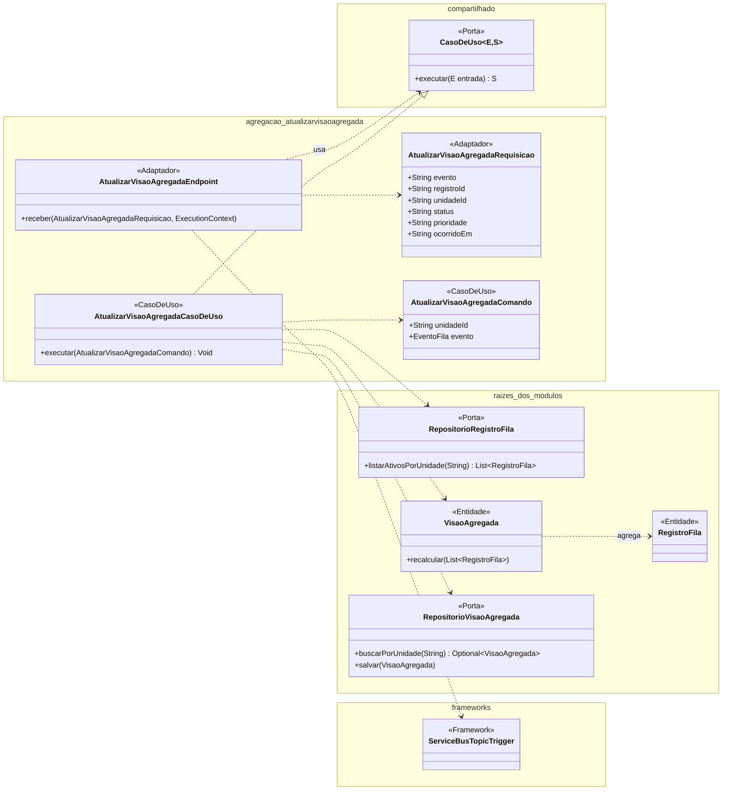

---

## 2. Diagramas de Componentes — cada fatia é uma coluna

Cada coluna, de cima para baixo: **Endpoint** (Adaptador) → **«interface» CasoDeUso‹Comando, Saída›** (Porta de entrada)
→ **CasoDeUso** → portas da raiz do módulo. Embaixo ficam a raiz do módulo (entidades, portas e adaptadores
compartilhados) e os sistemas externos. Notação: `requer` = consome a interface; `provê` = implementa a interface.

### 2.1 Módulo `fila`

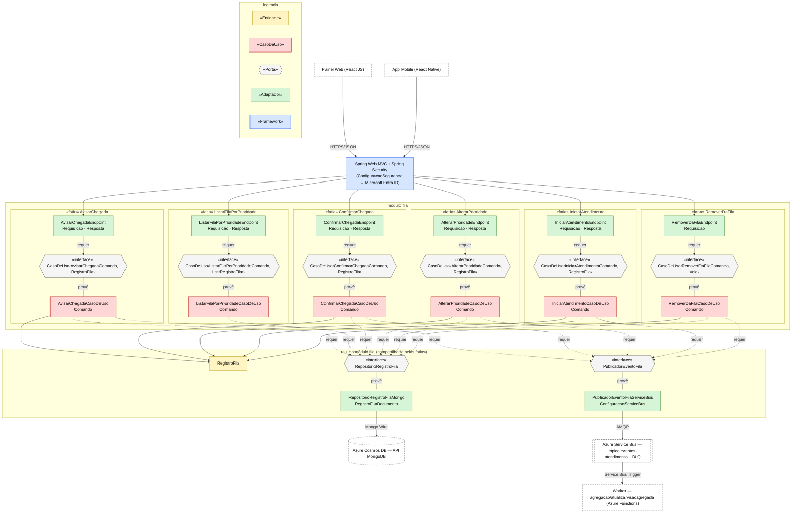

### 2.2 Módulos `unidade` e `agregacao` (Worker)

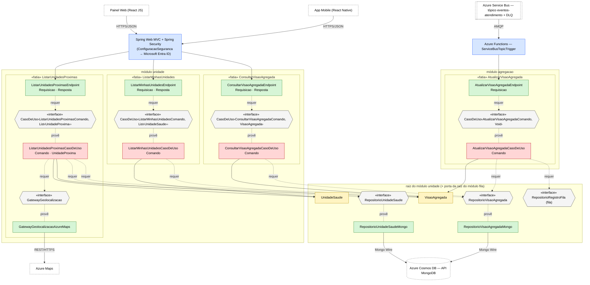

### 2.3 Módulo `consentimento`

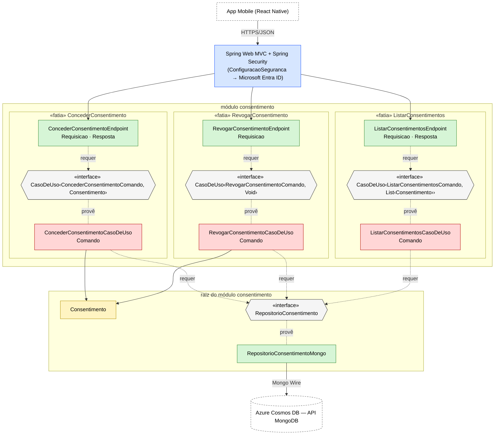

### 2.4 Módulos `prontuario` e `auditoria`

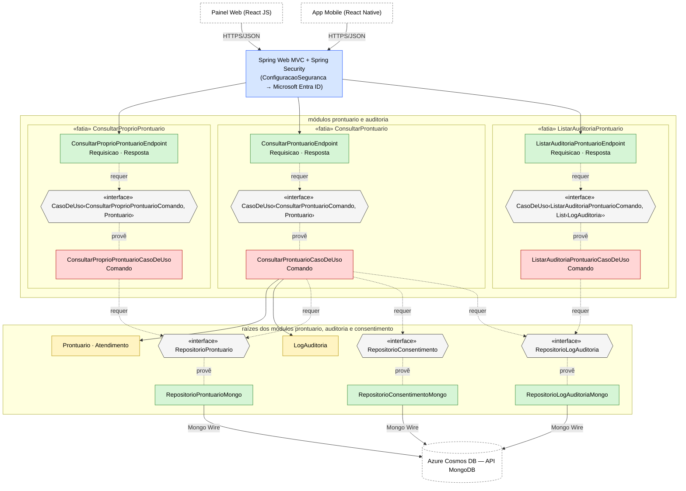

---

## 3. Fluxo da fatia de exemplo (AvisarChegada)

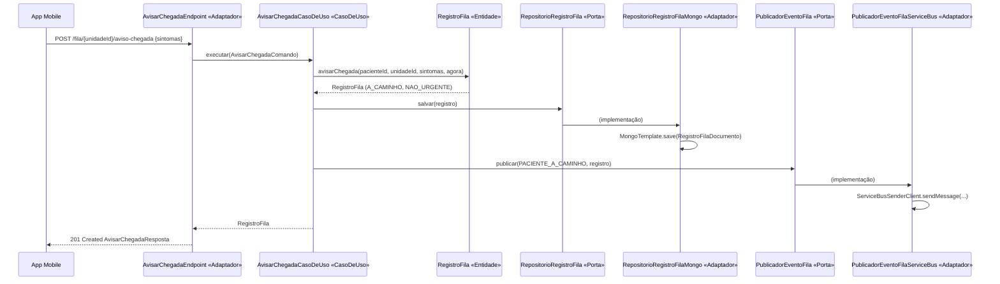

## Imagens

```bash
npx @mermaid-js/mermaid-cli -i docs/arquitetura-vertical-slice.md -o docs/img/arquitetura.png --size 4000
```

Um PNG por bloco, na ordem do documento: `arquitetura-1.png` (entidades), `-2` a `-7` (classes por fatia),
`-8` a `-11` (componentes) e `-12` (sequência).
